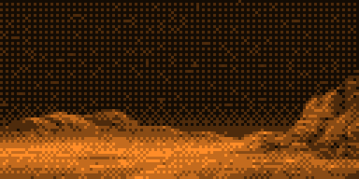
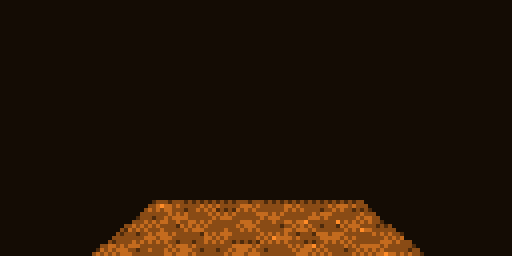
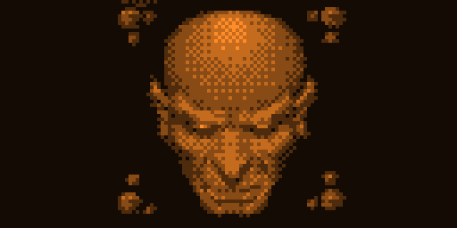

# Second Reality for Flipper Zero

A recreation of Future Crew's 1993 demo *Second Reality* on the Flipper Zero's 128x64 LCD, with temporal grayscale and the original music streamed to the speaker. Recall that the demo starts with a dark screen as the music slowly fades in - be patient. Requires firmware/SDK 1.5.1 or newer (API 88.2+).

<table>
  <tr>
    <td></td>
    <td></td>
  </tr>
  <tr>
    <td></td>
    <td></td>
  </tr>
</table>

## Controls

- Menu: **Play Demo**, **Display Setup**, **About**, or any of the 25 scenes.
- In a scene: **Back** = menu, **Left/Right** = previous/next scene, **OK** = pause.
- **Up/Down** = music volume (remembered). A scene picked from the menu
- Play Demo only: **Up/Down** = music volume (remembered). 
- Display Setup: Up/Down tune the panel refresh rate (hold for 1 Hz steps),
  Left/Right pick 1-bit dither or 3–9 gray levels. Back saves.

## Development

Everything was coded by AI. The first version was nearly complete with just a handful of prompts on Opus 5.5. Many more sessions were used to fix bugs, adjust rendering and display, reduce memory consumption, and apply some artistic license. This should be obvious, but this effort was like trying to cram 100kg of stuff into a 5kg bag so some concessions were made. The original demo relies on a larger resolution screen, 256 colors, and more available memory - all of which are lacking on the Flipper Zero. Decisions were made to improve the final output based on my own subjective ideas. Some concrete changes were:

- The original was designed for a 4x3 screen while the Flipper Zero is 2x1. Any scene that was letterboxed in the dmeo have been expanded to use the full LCD.
- Some 3D scenes had their field of view expanded while trying to preserve the original aspect ratio
- Some scenes, or parts of scenes, were brightened
- In an effort to boost framerates, SIMD instructions were used in some scenes (this was probably not necessary)
- Audio tracks were rendered as PCM data instead of implementing a tracker. This increased the .fap size and installation considerably.

## Building

Everything is generated from [Future Crew's source release](https://github.com/mtuomi/SecondReality). Some of the assets were missing/incorrect and thus pulled from the W32 version.

```sh
python3 tools/convert.py  /path/to/SecondReality --w32 /path/to/SecondRealityW32   # assets/  (pictures, fonts, 3D, tables)
python3 tools/timeline.py /path/to/SecondReality   # src/timeline.h (music sync points)
python3 tools/render_music.py /path/to/SecondReality  # music/*.pcm (needs libopenmpt, numpy)
ufbt launch                                        # dev build (no music inside): build, install, run
tools/upload_music.sh                              # dev only: music -> /ext/apps_data/second/
```

### Release build (the single .fap to share)

```sh
SECOND_RELEASE=1 ufbt          # -> ~/.ufbt/build/second.fap, about 15 MB, music included
SECOND_RELEASE=1 ufbt launch   # same, and install it on the Flipper
```

**Don't forget `SECOND_RELEASE=1`**: a plain `ufbt` build is a dev build of under 1 MB with no music in it, which plays silently unless the music was uploaded with `tools/upload_music.sh`. The release build needs `music/*.pcm` (from `tools/render_music.py`) and stops with an error if they're missing. 

The release `.fap` is all anyone needs: on its first launch the Flipper unpacks the music with the other assets to `/ext/apps_assets/second/` (about a minute and a half for the 14 MB; again after any update that changes the assets). Installing it over USB takes about two minutes. Dev builds stay small so that the usual build-install-test loop is quick.

`--w32` is a checkout of [Conspiracy's reconstruction](https://github.com/ConspiracyHu/SecondRealityW32). It supplies what the source release lacks: the second credits picture (the U2A ships, a "PARTPIC MISSING" placeholder there) and the final end scroller text and font (the release has a draft note and a font without Y and Z).

The release's S3M files are scrambled; `tools/fcmusic.py` unscrambles them. Music shaping for the piezo (high-pass, compression) is in `shape()` in `tools/render_music.py`.

## Desktop preview

Renders scenes as animated GIF files for testing.

```sh
make -C host preview SCENES=7        # host/out/s07.gif
make -C host preview SCENES=all S=10
host/build/sr_host -t assets         # print the Play All timeline
```

## Layout

- `src/display/` – grayscale display (subframe PWM, Bayer-offset phases)
- `src/gfx/` – frame, fills, images, fonts, 3D helpers
- `src/scenes/` – one file per scene; `u2.c` is the U2 polygon engine
- `src/runner.c` – menu runner and the Play All clock; `src/audio.c` – PCM to speaker
- `tools/` – converters; `host/` – preview harness

Scene code is an independent implementation 100% written by AI; the [JS port](https://github.com/covalichou/second-reality-js) was used only as a reference.
